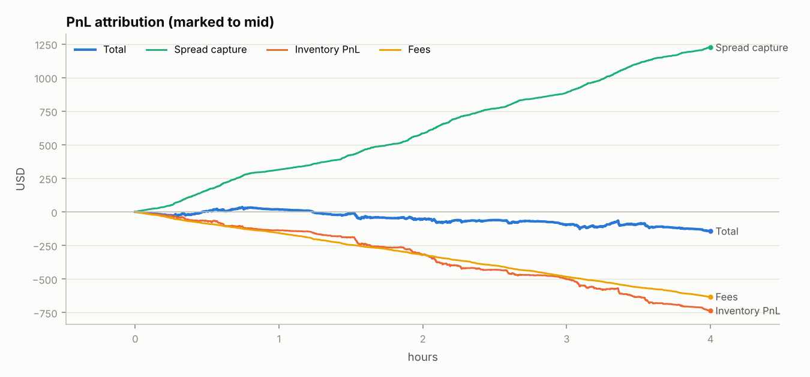
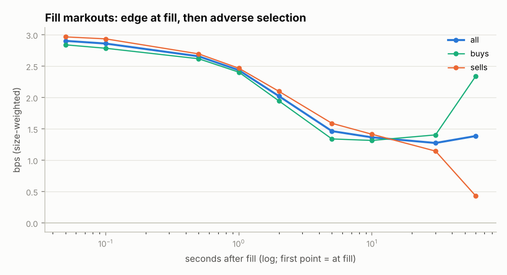
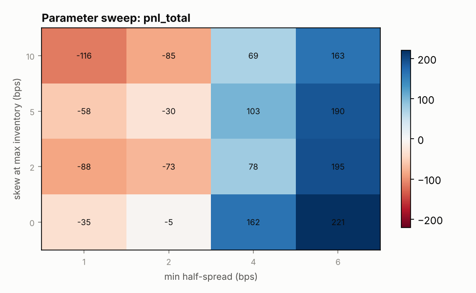

# Crypto market making: where does the PnL actually come from?

A research framework for passive market making on a crypto perpetual
(Hyperliquid BTC by default): record the live order book and tape, replay it
through an event-driven simulator with explicit latency and queue assumptions,
and **decompose the PnL** into spread capture, inventory PnL and fees, with
**fill markouts** to measure adverse selection.

The question this project answers is not "can I find a profitable bot?" but
**"why does a simple quoting strategy make or lose money, and which levers
(spread, inventory skew, volatility scaling, latency, fee tier) change that?"**

> Status: framework complete and tested; the figures below come from the
> synthetic demo dataset. Results on recorded Hyperliquid data go in
> [`notes/research_note.md`](notes/research_note.md).

## Pipeline

```
Hyperliquid websocket ──► recorder ──► raw .jsonl.gz (hourly)
                                         │
                                         ▼
                              data.py: book + trades tables (parquet)
                                         │
                strategy.py (quotes) ──► simulator.py (event-driven replay)
                                         │
                                         ▼
                analytics.py: PnL attribution · markouts · summary ──► reports/
```

| Module | What it does |
|---|---|
| `recorder.py` | Async websocket client: L2 snapshots + trades, reconnects with backoff, hourly gzip files, raw messages kept untouched |
| `data.py` | Parses raw files into clean `book` / `trades` tables, drops crossed books, checks the trade-side convention |
| `strategy.py` | Volatility-scaled spread + inventory skew, a practical form of Avellaneda–Stoikov (mapping in the docstring) |
| `simulator.py` | Event-driven replay: latency, post-only rejection, queue-aware fills, maker fees, exact PnL accounting |
| `analytics.py` | Markouts at 0.1s–60s, PnL decomposition, drawdown, time at inventory limit |
| `backtest.py` | CLI: single run, or parameter sweep chosen on the first half and evaluated on the second half |
| `synthetic.py` | Synthetic data with vol regimes, informed flow and sweeps, so everything runs offline |

## Key modelling choices (and their biases)

The fill model drives every MM backtest result, so it is explicit:

- **Print through our price** (a sell below our bid): the aggressor consumed
  our level, so we fill our **full** resting size.
- **Print at our price**: we are somewhere in the queue, so we fill
  `touch_fill_ratio × print size` (default 25%).
- **Latency**: a quote goes live `latency_ms` after the decision (default 50ms);
  if it would cross the book at that moment it is **rejected** (post-only).
- **No market impact**: the recorded tape doesn't react to our orders. This
  flatters results, more so with larger sizes.

Accounting identity, enforced by the test suite:

```
equity (cash + q·mid) = spread capture − fees + inventory PnL
spread capture = Σ side · qty · (mid at fill − fill price)
inventory PnL  = Σ q · Δmid
```

## Demo results (synthetic data, 4 hours)



The default parameters **capture spread** (about 2.9 bps per fill) but **lose
money**: inventory PnL and fees together exceed the spread captured.



The markout curve shows why. Edge at the moment of the fill is about 2.9 bps,
but it decays to about 1.4 bps within 10 seconds as informed flow moves the
price against the position. That residual sits **below the 1.5 bps maker
fee**, so every fill loses on average. Three ways out: a better fee tier (or
rebates), wider quotes when flow is toxic, or a short-term signal that avoids
being picked off.



Parameter sweep, selected on the first 2 hours and tested on the last 2:
wider spreads win in-sample (best train PnL **+221**) and stay profitable
out-of-sample (**+160**) with fewer fills. On this synthetic data, inventory
skew *hurts*: it makes the bot quote more aggressively on the side that
reduces inventory, which is often the side informed flow is about to hit.
Whether that holds on real data is one of the questions for the research note.

## Quickstart

```bash
pip install -e ".[dev]"
pytest                                   # 8 tests, including the accounting identity

# offline demo
python -m mmlab.backtest --synthetic --out reports/demo
python -m mmlab.backtest --synthetic --sweep --out reports/demo_sweep

# real data: record for a few days or weeks (run on an always-on VM)
python -m mmlab.recorder --coins BTC ETH --out data/raw
python -m mmlab.data --raw data/raw/BTC --out data/processed/BTC
python -m mmlab.backtest --data data/processed/BTC --tick 1 --out reports/btc
python -m mmlab.backtest --data data/processed/BTC --tick 1 --sweep --out reports/btc_sweep
```

Each run writes `summary.json`, `fills.csv`, `markout_curve.csv` and PNG
figures to the output folder.

Before trusting results on real data:

- Check the **tick size** for the coin (Hyperliquid prices use at most 5
  significant figures, so BTC trades in $1 ticks around $100k).
- Check the current **maker fee** for your volume tier and pass it with
  `--maker-fee` (negative for a rebate).
- Run `python -m mmlab.data`, which prints a trade-side sanity check; it
  should be close to 1.0.

## Next steps

- [ ] Record 2–4 weeks of BTC and ETH data and redo the analysis on it
- [ ] Toxicity filter: widen or pull quotes when order book imbalance or recent trade flow is one-sided
- [ ] Sensitivity of PnL to latency (10ms → 500ms) and to `touch_fill_ratio`
- [ ] Hedging inventory on another venue instead of skewing
- [ ] Small live deployment on Hyperliquid testnet via the official Python SDK, comparing live fills with simulated fills (fill-model validation)

## References

- Avellaneda, M. & Stoikov, S. (2008). *High-frequency trading in a limit order book*. Quantitative Finance.
- Guéant, O., Lehalle, C.-A. & Fernandez-Tapia, J. (2013). *Dealing with the inventory risk: a solution to the market making problem*.
- Cartea, Á., Jaimungal, S. & Penalva, J. (2015). *Algorithmic and High-Frequency Trading*. Cambridge University Press.
- Hyperliquid API documentation (websocket subscriptions, fees, tick sizes).
